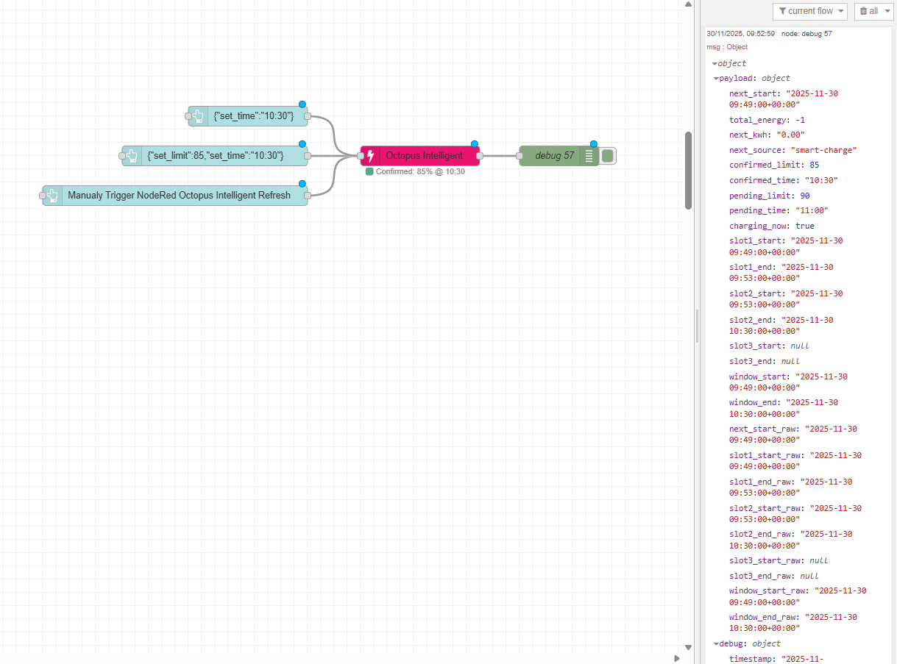
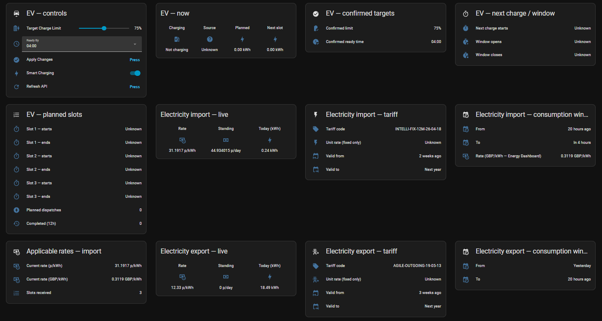
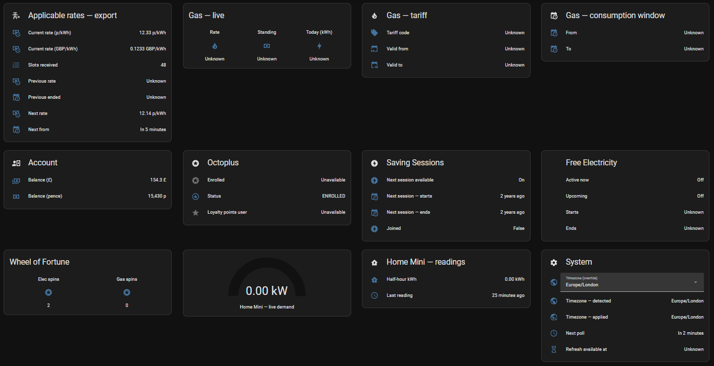
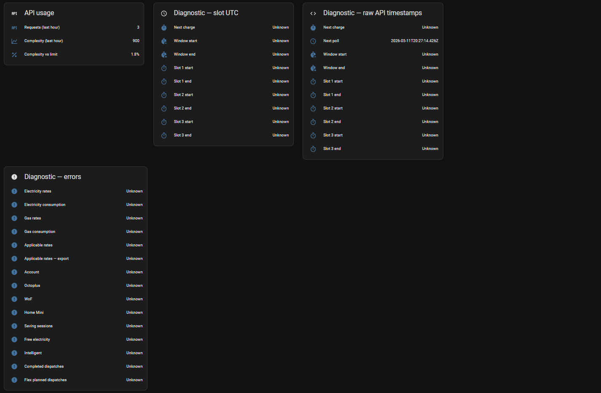
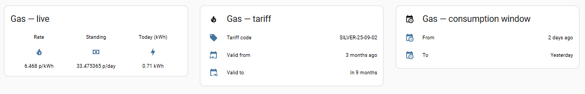

# node-red-contrib-octopus-intelligent

> Node-RED integration for **Octopus Energy** with automatic Home Assistant MQTT discovery

Monitor electricity and gas rates (import + export), EV charging schedules, real-time home energy usage, account balance, saving sessions, and Wheel of Fortune spins. MQTT discovery sets them all up as Home Assistant entities.

[](https://www.npmjs.com/package/node-red-contrib-octopus-intelligent)
[](https://opensource.org/licenses/MIT)

---

## 🤝 Support This Project

Found this useful? Support continued development:

<table>
<tr>
<td width="33%" align="center">

### ⭐ GitHub Star
Star the repository to show your support!

[⭐ Star on GitHub](https://github.com/ASomerN/node-red-contrib-octopus-intelligent)

</td>
<td width="33%" align="center">

### 💖 Sponsor
Support ongoing development and maintenance

[Become a Sponsor](https://github.com/sponsors/ASomerN)

</td>
<td width="33%" align="center">

### ☕ Buy Me a Coffee
If this project has helped you!

[](https://www.paypal.com/donate?hosted_button_id=A2B8ZFEJBE2S6)

</td>
</tr>
</table>

**Your support helps with:** Bug fixes and maintenance • New feature development • Documentation improvements • Community support • Feeding my children

---

## ✨ Features

### 🎮 EV Smart Controls
- **Target Charge Slider** (5–100%) — Set your desired battery level
- **Ready Time Dropdown** (any half-hour slot, 00:00–23:30) — When your car needs to be ready. Matches the Octopus app; other values are rejected with an error and nothing is sent to Octopus.
- **Apply Changes Button** — In Home Assistant, press Apply Changes to send the new target and ready time. A command from a flow is sent at once.
- **Confirmed Values** — See your current API-validated settings
- **Smart Charging Toggle** — Suspend or resume Octopus intelligent charging from Node-RED or Home Assistant. Each charging poll reads the current state, so a change made in the Octopus app shows up too.

### ⚡ Real-Time Charging Data
- **Next Charge Time** — When your next slot starts
- **Total Planned Energy** — Total kWh across all upcoming slots
- **Individual Slot Times** — Up to 3 slots with start/end times
- **Charging Window** — Overall window from first to last slot
- **Charge Source** — Smart-charge vs bump-charge indicator
- **Completed Dispatches** — History of completed intelligent charging sessions
- **Flex Planned Dispatches** — Upcoming flex dispatch schedule

### 🔌 Electricity & Gas Rates
- **Live Unit Rate** — Current electricity rate (p/kWh) and gas rate (p/kWh)
- **Standing Charges** — Daily standing charges for electricity and gas
- **Tariff Code** — Your current tariff identifier and validity dates
- **Recent Consumption** — Previous day kWh for electricity (import + export) and gas
- **Current Rate Slot** — Live rate from your 24h applicable rates schedule
- **Previous / Next Rate** — Adjacent slot rates and transition timestamps
- **Energy Dashboard Rate** — Electricity rate in GBP/kWh, ready for HA's Energy Dashboard cost tracking

### 🌞 Electricity Export (Solar / Battery)
- **Export Tariff** — Tariff code, standing charge, validity dates for the OUTGOING agreement
- **Export Half-Hourly Rates** — Full 48-slot schedule for variable export tariffs (e.g. Agile Outgoing)
- **Live Export Rate** — Current p/kWh and GBP/kWh
- **Previous / Next Export Rate** — Adjacent slot rates and transition timestamps
- **Export Consumption** — Previous day kWh exported to the grid (read from the export meter point)

### 🏠 Home Energy (Octopus Home Mini)
- **Live Demand** — Real-time grid import in kW
- **Period Consumption** — Energy consumed in the last half-hour period (kWh)
- Requires Octopus Home Mini device registered to your account (opt-in)

### 💰 Account & Rewards
- **Account Balance** — Current credit/debit balance in £
- **Saving Sessions** — Next session availability, start/end times, joined status, and Octopus Points
- **Free Electricity** — Upcoming free electricity window detection (active June–October)
- **Wheel of Fortune** — Remaining electricity and gas spins (opt-in)
- **Octoplus** — Enrollment status and loyalty points

### 🚗 SmartFlex Vehicle and Inverter
- **Vehicle Details**: Make, model, battery size, charger power, and what Octopus says the device is doing
- **Charging Sessions**: Your last 5 sessions, with energy added, final charge, cost, and any problems
- **Boost Charge**: Start or cancel a boost with `set_boost`
- **Inverter Data (experimental)**: Solar, home battery, grid, and site power. Off by default.

### 🔧 Advanced Features
- **Account Discovery** — Automatic product detection at startup; categories auto-enable based on registered products
- **Per-Category Polling** — Each data group polls on its own schedule. You set some intervals in the editor, and the rest are fixed.
- **Manual Refresh Button** — Force API refresh from Home Assistant (30s cooldown)
- **Next Poll Timer** — An estimate of the next automatic refresh
- **API Usage Tracking** — Monitor requests and complexity in diagnostics
- **Exponential Backoff** — Smart retry prevents sensor unavailability
- **Error Fields and Status** — Each data group has its own `*_error` field in `msg.payload`. The node status and the Node-RED log show the rest.

### 🏡 Home Assistant Integration
- **Zero Configuration** — MQTT auto-discovery sets everything up
- **Two-Tier Entity Organisation** — Main entities (controls, live rates, consumption, tariff metadata, rewards) and Diagnostics (errors, raw timestamps, API metrics, locale timestamps)
- **Suggested Area** — Auto-suggests "Energy" area
- **Reference dashboard YAML** — `examples/ha-dashboard.yaml` covers all controls (including the Smart Charging, Charge Cap, and Boost Charge switches), live values, SmartFlex vehicle cards, and the error state binary sensors in a packed sections layout, ready to paste into HA's Raw Configuration Editor. A few diagnostic sensors and the experimental inverter entities are left out.
- **Node-RED Dashboard 2.0 example** — `examples/node-red-dashboard-flow.json` is an importable [@flowfuse/node-red-dashboard](https://github.com/FlowFuse/node-red-dashboard) flow whose Controls page has the target limit, all 48 ready-by times, the Smart Charging, Charge Cap, and Boost Charge switches, refresh, and the timezone override. Its Status page shows the SmartFlex vehicle and recent charging sessions.

### 🌍 Timezone Support
- **Locale Timestamps** (`*_locale` fields) — always in server auto-detected timezone
- **Resolved Display Fields** — slot and window times in your configured timezone
- **HA Timezone Select** — change timezone from Home Assistant without redeploying
- **Node Config Override** — set IANA timezone directly in the node editor
- **Zero Dependencies** — native `Intl` API, no new packages

---

## 📸 Screenshots

### Node Configuration


Configure your account credentials, polling intervals, and MQTT broker in the node editor. The MQTT Broker dropdown connects directly to your Home Assistant Mosquitto instance. Per-category intervals set how often the node polls each data source. Electricity and gas rates update hourly by default, while Home Mini polls every minute for live demand.

### Node-RED Flow Example



### Home Assistant — Dashboard

`examples/ha-dashboard.yaml` is a Lovelace dashboard with all controls, live values, and error state binary sensors. A few diagnostic sensors and the experimental inverter entities are left out. Paste it into HA's Raw Configuration Editor to get the layout below. The layout uses HA's sections view and packs cards uniformly across up to 4 columns on wide screens. The EV controls card includes the Smart Charging, Charge Cap, and Boost Charge switches. The SmartFlex vehicle cards hide on accounts without a SmartFlex car or charge point. The screenshots below predate the Charge Cap and Boost Charge switches.

#### EV controls, electricity import & export



EV target slider and ready-time dropdown at top, then live import rate / standing / today's kWh, full import tariff card, half-hourly applicable rates summary, and the same trio for export (live export rate, export tariff, export consumption, half-hourly Agile Outgoing rates).

#### Gas, account, rewards, Home Mini



Gas rate / standing / consumption + tariff. Account balance, Octoplus enrolment, Saving Sessions card, Free Electricity card, Wheel of Fortune spins, and the Home Mini live-demand gauge with current half-hour kWh.

#### Diagnostics — UTC timestamps, raw timestamps, errors



UTC-class slot/window timestamps (HA renders them as relative "n hours ago"), raw API strings for verbatim debugging, timezone + API usage rows, and a consolidated error panel covering every category.

#### Gas — live data from a real account



For accounts with a gas meter point, the gas card shows the live tariff code, unit rate (p/kWh), standing charge, daily consumption (kWh), and tariff validity dates. The screenshot shows v1.3.0 reading a real account on the Octopus standard variable gas tariff.

#### Seasonal / conditional entities — when they show "Unavailable"

| Sensor | Active period | Outside season / condition |
|---|---|---|
| Saving Session Start / End | October–March | `null` — no sessions scheduled |
| Free Electricity Start / End | typically June–October | `null` — no sessions scheduled |
| Electricity / Gas Tariff Valid To | When tariff has an end date | `null` — open-ended tariff |
| Gas entities | Only if account has a gas meter point | `null` — electricity-only accounts |
| Home Mini | Only if a Home Mini device is registered | Entities are still created and stay empty |
| Electricity Export entities | Only if account has an OUTGOING agreement | Entity values null without an export tariff |
| EV planned slots / dispatches | Only when a charge is scheduled | `null` between plug-in cycles |

This is normal. The node publishes the entity definitions so HA registers them, and the values fill in when the API returns data for that period.

---

## 📋 Requirements

- **Node-RED** v2.0+
- **Octopus Energy Account** — any electricity account works for rates/consumption/account data
  - [Intelligent Octopus Go](https://octopus.energy/intelligent/) tariff required for EV charging features
  - Octopus Home Mini device required for real-time consumption (opt-in)
  - Wheel of Fortune is opt-in and requires an active electricity agreement
- **API Key** — [Generate here](https://octopus.energy/dashboard/new/accounts/personal-details/api-access)
- **MQTT Broker** (optional, for Home Assistant integration)
- **Home Assistant** (optional, for MQTT features)

---

## 🚀 Quick Start

### 1. Install via Node-RED Palette

1. Open Node-RED → **Menu** → **Manage Palette**
2. **Install** tab → Search `node-red-contrib-octopus-intelligent`
3. Click **Install**

### 2. Get Your Credentials

**Account Number** (format: `A-XXXXXXXX`):
- Found at https://octopus.energy/dashboard/

**API Key** (format: `sk_live_...`):
- Get from https://octopus.energy/dashboard/new/accounts/personal-details/api-access
- Click "Generate API Key"

### 3. Configure the Node

1. Drag **Octopus Intelligent** into your flow
2. Double-click to configure:
   - Account Number (format: `A-XXXXXXXX`)
   - API Key (stored securely)
   - Intelligent (Min) sets the charging data poll interval. The default is 5 minutes.
   - Intervals for electricity, gas, Wheel of Fortune, and Home Mini (all optional)
   - Untick Electricity to stop the electricity rates and consumption polls. The node still polls applicable rates and free electricity while your account has an electricity meter.
   - ☑ Enable Home Mini: tick if you have an Octopus Home Mini device
   - ☑ Enable Wheel of Fortune: tick to track remaining spins
   - ☐ Inverter (experimental): tick only if Octopus controls your solar inverter. Off by default.
   - Tick Enable Home Assistant MQTT and choose a broker to publish to Home Assistant
3. **Deploy** — account discovery runs automatically and enables categories based on your registered products

### 4. Home Assistant (Optional)

If MQTT enabled:
1. Wait ~5 seconds after deploy
2. **Settings** → **Devices & Services** → **MQTT**
3. Find "Octopus Intelligent" device
4. The entities are already there. No YAML is needed.

---

## ⬆️ Upgrading to v1.7.0

v1.7.0 adds features. Existing flows, automations, and dashboards keep working, with one change for MQTT commands.

- The node now ignores retained messages on `submit_changes`, `refresh`, `set_smart_charging`, `set_charge_cap`, and `set_boost`, and logs one warning per topic. Home Assistant does not retain these commands, so its buttons and switches work as before. If your own flow publishes one of these commands with retain set, turn retain off. To clear an old retained message, publish an empty retained message to that topic.
- With a SmartFlex car or charge point, 11 new entities appear in Home Assistant: the Boost Charge switch and 10 vehicle entities. Octopus lists a charge point as an electric vehicle, so it gets the same entities. See Home Assistant Entities below for the counts.
- The experimental Inverter option is off, so nothing changes for inverters until you tick it.
- If you go back to an older version, the new entities stay in Home Assistant. The vehicle entities show Unavailable, and the Boost Charge switch keeps its last state and does nothing. The broker still holds their retained discovery config, so Home Assistant will not delete them one by one. To remove them, clear their retained discovery topics on the broker (`homeassistant/.../nodered_<account>_<id>/config`), for example with MQTT Explorer. Or delete the Octopus Intelligent device in Home Assistant: that clears the topics, but you lose the names and areas you set and any entity ids you changed. If you ticked Inverter, untick it and deploy before you go back, and the node removes the inverter entities for you.

## ⬆️ Upgrading from v1.2.x

v1.3.0 only adds features and has no breaking changes. Existing flows, automations, and dashboards keep working.

**What happens on upgrade:**
- All existing entity IDs are preserved (HA's MQTT integration matches by `unique_id`, which is stable)
- All v1.2.x payload fields remain in the same positions
- About 70 new sensors appear in Home Assistant after the first poll. They cover electricity import and export tariffs and rates, gas tariff and consumption, Home Mini, Octoplus, saving sessions, free electricity, Wheel of Fortune, account balance, and applicable rates.
- New node config options (Home Mini, Wheel of Fortune) default to off
- Two existing Octoplus booleans (`octoplus_enrolled`, `octoplus_loyalty_points_user`) move from the `sensor.` to the `binary_sensor.` domain. A fresh install picks the right domain, but an upgrade may register both. Delete the old `sensor.` entries in Dev Tools if you want a tidy device card.

If you installed an early dev build of v1.3 and have stale entities in Home Assistant, see [Stale Entities After Early v1.3 Dev Build](#stale-entities-after-early-v13-dev-build) in the Troubleshooting section.

---

## 📊 Home Assistant Entities

**175 MQTT entities** are published under a single **Octopus Intelligent** device on a fresh install with a car or charge point Octopus smart-charges. Without one, the 10 vehicle entities and the Boost Charge switch are left out and the count is **164**. If you tick the experimental **Inverter** option and Octopus lists an inverter on your account, 14 more are added (**189** with a car). All entities are organised into two tiers: **Main** (controls, live data, tariff metadata, rewards) and **Diagnostics** (errors, raw timestamps, locale timestamps, API metrics).

If your device card shows more entities than these counts, the extras are likely leftovers from earlier installed versions or interrupted discovery. They can be deleted via Settings → Devices & Services → MQTT → Octopus Intelligent → entity → cog → "Delete from registry" without affecting current operation.

### Node-RED payload vs MQTT entities

`msg.payload` from the Node-RED node contains more than 150 fields. Some payload fields are intentionally **not** exposed as individual HA entities; they exist for template/automation use inside Node-RED or HA Jinja:

| Category | Fields (count) | Why no MQTT entity |
|---|---|---|
| Bulk array data | `applicable_rates`, `electricity_export_rate`, `completed_dispatches`, `flex_planned_dispatches` (4) | Each is an array of 48 half-hour slots or N dispatches. Exposing each row as an MQTT entity would clutter the registry. The `_count` summary entity exists; consume the full array via templates / `apexcharts-card` for visualisation. |
| Pending controls | `pending_limit`, `pending_time` (2) | The number/select control entities (`Target Charge`, `Ready By`) render the pending value through their own `value_template`. No separate sensor entity needed. |
| Cost placeholders | `electricity_consumption_cost`, `gas_consumption_cost` (2) | Reserved for a future cost calculation (consumption × rate). Always `null`. |
| Vestigial | `saving_session_points` (1) | Octopus moved points to the Octoplus query. The field is always `null`. A sensor named Octopus Octopus Points still exists and is always empty. Use `octoplus_loyalty_points_user` for Octoplus. |

**Implication for HA users.** Every value you might want to show is reachable. Direct values use the MQTT entity. Previous and next import rates are available as diagnostic sensors.

### Controls

These entities take commands. **Timezone**, **Smart Charging**, and **Charge Cap** carry the HA `entity_category: config` flag, because they are settings you change.

| Name | Description |
|---|---|
| Octopus Target Charge | Slider (5–100%) — set desired battery charge level; shows the pending value until applied |
| Octopus Ready Time | Dropdown (00:00–23:30, half-hour slots) — time by which the car must be ready. Other values are rejected with an error and nothing is sent to Octopus |
| Octopus Apply Changes | Submit pending limit/time changes to the Octopus API |
| Octopus Refresh API | Force an immediate API refresh (30-second cooldown enforced) |
| Timezone | Display timezone for all slot and window times, with 15 IANA options |
| Smart Charging | Enable (unsuspend) or disable (suspend) Octopus intelligent charging |
| Charge Cap | Limit smart charging to off-peak rates only (as in the Octopus app) |
| Boost Charge | Start charging now, outside the Octopus plan. Turn off to cancel the boost. Only published when Octopus lists a car or charger it controls |

### Binary Sensors

| Name | Description |
|---|---|
| Octopus Charging Now | `ON` while the EV is inside a dispatch charging slot or a boost is running |
| Octopus Saving Session Available | `ON` if a saving session is upcoming or joinable |
| Octopus Free Electricity Active | `ON` while a free electricity window is in progress right now |
| Octopus Free Electricity Available | `ON` if a free electricity window is scheduled in the future |
| Octopus Octoplus Enrolled | `ON` if the account is enrolled in Octoplus |
| Octopus Octoplus Loyalty Points | `ON` if the account participates in Octoplus loyalty points (boolean flag from the API) |
| Octopus Saving Session Joined | On when you have joined the current saving session campaign |
| Octopus Saving Session Window Active | On while a saving session window is open, joined or not |
| Octopus Saving Session Active | On while a saving session window is open and you have joined |
| Octopus Last Charge Session Problem | `ON` if the latest finished charging session had a problem. Only with a SmartFlex car or charge point |

### Main Sensors — EV Charging

| Name | Description |
|---|---|
| Octopus Confirmed Charge Limit | API-confirmed target charge percentage — last setting accepted by Octopus |
| Octopus Confirmed Ready Time | API-confirmed ready time — last setting accepted by Octopus |
| Octopus Next Charge Time | Start time of the next planned charging slot (display timezone) |
| Octopus Total Planned Energy | Total kWh across all upcoming planned dispatch slots |
| Octopus Next Slot Energy | Energy (kWh) scheduled for the next individual slot |
| Octopus Charge Source | Source of next charge: `smart-charge` (scheduled by Octopus algorithm) or `bump-charge` (car plugged in outside schedule) |
| Octopus Slot 1 Start | Start time of planned slot 1 |
| Octopus Slot 1 End | End time of planned slot 1 |
| Octopus Slot 2 Start | Start time of planned slot 2 (`null` if fewer than 2 slots) |
| Octopus Slot 2 End | End time of planned slot 2 |
| Octopus Slot 3 Start | Start time of planned slot 3 (`null` if fewer than 3 slots) |
| Octopus Slot 3 End | End time of planned slot 3 |
| Octopus Overall Window Start | Start of the first planned slot — when the charging window opens |
| Octopus Overall Window End | End of the last planned slot — when the charging window closes |
| Octopus Completed Dispatches | Count of completed intelligent dispatch sessions on record |
| Octopus Flex Planned Dispatches | Count of upcoming flex dispatch slots |

### Main Sensors, SmartFlex Vehicle

Only published when Octopus lists a SmartFlex car or charge point on your account.

| Name | Description |
|---|---|
| Octopus Last Charge Session Energy | kWh added in the latest finished charging session. The last 5 sessions and the device alerts are attributes. Each new session starts a new total, so Home Assistant keeps statistics and you can add it to the Energy dashboard as an individual device |
| Octopus Last Charge Session Final Charge | Battery percentage at the end of the latest finished session |

### Main Sensors — Electricity (Import)

| Name | Description |
|---|---|
| Octopus Electricity Standing Charge | Daily electricity standing charge (p/day) from current tariff |
| Octopus Electricity Consumption | Electricity consumed in the previous day (kWh) from the import meter |
| Octopus Current Electricity Rate | Live unit rate (p/kWh) from the 24h applicable rates schedule — use this on half-hourly tariffs (e.g. Intelligent Octopus Go) instead of Electricity Unit Rate |
| Octopus Electricity Rate | Live unit rate in GBP/kWh — measurement state class, ready for the HA Energy Dashboard |
| Octopus Electricity Unit Rate | Fixed unit rate (p/kWh) — `null` on half-hourly tariffs |
| Octopus Electricity Tariff Code | Current import tariff product code |
| Octopus Electricity Tariff Valid From / Valid To | Validity window of the current import tariff (`Valid To` is `null` for open-ended tariffs) |
| Octopus Electricity Day Rate | Day rate in p/kWh on tariffs with rate bands |
| Octopus Electricity Night Rate | Night rate in p/kWh on tariffs with rate bands |
| Octopus Electricity EV Peak Rate | EV peak rate in p/kWh on four-rate EV tariffs |
| Octopus Electricity EV Off-Peak Rate | EV off-peak rate in p/kWh on four-rate EV tariffs |

### Main Sensors — Electricity (Export)

| Name | Description |
|---|---|
| Octopus Electricity Export Standing Charge | Daily export standing charge (p/day) — typically `0` for Agile Outgoing |
| Octopus Electricity Export Consumption | Electricity exported to the grid in the previous day (kWh) from the export meter |
| Octopus Current Electricity Export Rate | Live export rate (p/kWh) for the current half-hour slot |
| Octopus Electricity Export Rate | Live export rate (GBP/kWh) — measurement state class |
| Octopus Electricity Export Unit Rate | Fixed unit rate — `null` on half-hourly export tariffs (e.g. Agile Outgoing) |
| Octopus Electricity Export Tariff Code | Current export tariff product code (e.g. `AGILE-OUTGOING-19-05-13`) |
| Octopus Electricity Export Tariff Valid From / Valid To | Validity window of the current export tariff |

### Main Sensors — Gas

| Name | Description |
|---|---|
| Octopus Gas Standing Charge | Daily gas standing charge (p/day) from current tariff |
| Octopus Gas Consumption | Gas consumed in the previous day (kWh) |
| Octopus Gas Unit Rate | Gas unit rate (p/kWh) |
| Octopus Gas Tariff Code | Gas product code |
| Octopus Gas Tariff Valid From / Valid To | Validity window of the current gas tariff |

### Main Sensors — Account & Rewards

| Name | Description |
|---|---|
| Octopus Account Balance | Current account credit or debit balance (£) |
| Octopus WoF Electricity Spins | Wheel of Fortune electricity spins remaining (opt-in) |
| Octopus WoF Gas Spins | Wheel of Fortune gas spins remaining (opt-in) |

### Main Sensors — Home Mini

| Name | Description |
|---|---|
| Octopus Home Mini Demand | Real-time grid import in kW — requires Octopus Home Mini and opt-in checkbox in node config |
| Octopus Home Mini Period Consumption | Energy consumed in the current half-hour period (kWh) |

### Main Sensors — Account, Octoplus, Rewards (continued)

The following appear in the main device entity list (not the Diagnostics tab):

| Name | Description |
|---|---|
| Octopus Octoplus Status | Octoplus enrollment status string (e.g. `ENROLLED`) |
| Octopus Saving Session Start / End | Start and end of the next saving session (`null` outside October–March) |
| Octopus Free Electricity Start / End | Start and end of the next free electricity window (`null` outside the active period) |

### Diagnostic Sensors

Appears under the **Diagnostics** tab of the HA device card.

#### Polling & Refresh

| Name | Description |
|---|---|
| Octopus Next Poll Time | Estimate of the next automatic API refresh |
| Octopus Refresh Available At | Timestamp when the manual refresh cooldown expires (`null` = available now) |

#### API Usage

| Name | Description |
|---|---|
| Octopus API Requests (Last Hour) | Number of API calls made in the last 60 minutes |
| Octopus API Complexity (Last Hour) | Total estimated GraphQL complexity used in the last hour |
| Octopus API Complexity Usage | Percentage of the 50,000/hour GraphQL complexity limit consumed |

#### Raw Timestamps (UTC)

Exact UTC strings from the API, unaffected by timezone settings. Use these when you need unambiguous UTC values in automations.

| Name | Description |
|---|---|
| Octopus Next Charge Time (Raw) | Next charge time — exact UTC string from API |
| Octopus Next Poll Time (Raw) | Next poll time — exact UTC string |
| Octopus Slot 1 Start (Raw) | Slot 1 start — exact UTC from API |
| Octopus Slot 1 End (Raw) | Slot 1 end — exact UTC from API |
| Octopus Slot 2 Start (Raw) | Slot 2 start — exact UTC from API |
| Octopus Slot 2 End (Raw) | Slot 2 end — exact UTC from API |
| Octopus Slot 3 Start (Raw) | Slot 3 start — exact UTC from API |
| Octopus Slot 3 End (Raw) | Slot 3 end — exact UTC from API |
| Octopus Overall Window Start (Raw) | Window start — exact UTC from API |
| Octopus Overall Window End (Raw) | Window end — exact UTC from API |

#### Server-Timezone Timestamps (Locale)

Times in the Node-RED server's auto-detected timezone. Unlike display fields, these are never affected by the Timezone selector or `set_timezone` command.

| Name | Description |
|---|---|
| Octopus Next Charge Time (Locale) | Next charge time in Node-RED server timezone |
| Octopus Slot 1 Start (Locale) | Slot 1 start in server timezone |
| Octopus Slot 1 End (Locale) | Slot 1 end in server timezone |
| Octopus Slot 2 Start (Locale) | Slot 2 start in server timezone |
| Octopus Slot 2 End (Locale) | Slot 2 end in server timezone |
| Octopus Slot 3 Start (Locale) | Slot 3 start in server timezone |
| Octopus Slot 3 End (Locale) | Slot 3 end in server timezone |
| Octopus Overall Window Start (Locale) | Window start in server timezone |
| Octopus Overall Window End (Locale) | Window end in server timezone |
| Octopus Timezone Detected | IANA timezone auto-detected from the Node-RED server (e.g. `Europe/London`) |
| Octopus Timezone Applied | Active timezone currently used for all display timestamp fields |

#### Consumption Metadata

| Name | Description |
|---|---|
| Octopus Electricity Consumption From | Start of the electricity (import) consumption measurement period |
| Octopus Electricity Consumption To | End of the electricity (import) consumption measurement period |
| Octopus Electricity Export Consumption From | Start of the export consumption measurement period |
| Octopus Electricity Export Consumption To | End of the export consumption measurement period |
| Octopus Gas Consumption From | Start of the gas consumption measurement period |
| Octopus Gas Consumption To | End of the gas consumption measurement period |

#### Applicable Rates — Import + Export

| Name | Description |
|---|---|
| Octopus Applicable Rates Slots | Number of import rate slots in the current 24-hour window |
| Octopus Electricity Export Rate Slots | Number of export rate slots in the current 24-hour window |
| Octopus Electricity Export Rate Prev | Previous half-hour export rate (p/kWh) |
| Octopus Electricity Export Rate Prev Ends | Timestamp when the previous export slot ended |
| Octopus Electricity Export Rate Next | Next half-hour export rate (p/kWh) |
| Octopus Electricity Export Rate Next From | Timestamp when the next export slot begins |
| Octopus Applicable Rates Min / Max / Median / Avg | Lowest, highest, median, and average import rate in the next 24 hours (p/kWh) |
| Octopus Electricity Export Rate Min / Max / Median / Avg | The same four values for export (p/kWh) |
| Octopus Applicable Rate Prev / Next | Previous and next import rate (p/kWh) |
| Octopus Applicable Rate Prev (GBP) / Next (GBP) | Previous and next import rate in pounds per kWh |
| Octopus Applicable Rate Prev Ends / Next From | When the previous slot ends and the next slot starts |
| Octopus Electricity Export Rate Prev (GBP) / Next (GBP) | Previous and next export rate in pounds per kWh |

#### Error & Detail Sensors

`null` = healthy. Non-null = the last error message from that API category.

| Name | Description |
|---|---|
| Octopus Electricity Rates Error | Last error fetching electricity rates |
| Octopus Electricity Consumption Error | Last error fetching electricity consumption |
| Octopus Gas Rates Error | Last error fetching gas rates |
| Octopus Gas Consumption Error | Last error fetching gas consumption |
| Octopus Applicable Rates Error | Last error fetching the import applicable rates schedule |
| Octopus Electricity Export Rate Error | Last error fetching the export applicable rates schedule. The same text is in `applicable_rates_export_error` in `msg.payload`. |
| Octopus Account Balance (Pence) | Account balance in pence (raw integer) |
| Octopus Account Error | Last error fetching account data |
| Octopus Octoplus Error | Last error fetching Octoplus data |
| Octopus WoF Electricity Max | Always empty. Octopus no longer provides it. Use the Spins sensor. |
| Octopus WoF Electricity Used | Always empty. Octopus no longer provides it. Use the Spins sensor. |
| Octopus WoF Gas Max | Always empty. Octopus no longer provides it. Use the Spins sensor. |
| Octopus WoF Gas Used | Always empty. Octopus no longer provides it. Use the Spins sensor. |
| Octopus WoF Error | Last error fetching Wheel of Fortune data |
| Octopus Home Mini Reading Time | Timestamp of the most recent Home Mini telemetry reading |
| Octopus Home Mini Error | Last error fetching Home Mini data |
| Octopus Saving Sessions Error | Last error fetching saving sessions data |
| Octopus Free Electricity Error | Last error fetching free electricity data |
| Octopus Completed Dispatches Error | Last error fetching completed dispatch history |
| Octopus Flex Planned Dispatches Error | Always empty today. Flex dispatch errors appear in Intelligent Error. |
| Octopus Intelligent Error | Last error from the intelligent charging (EV slots) query. A short text with the Octopus code, for example `KT-CT-4340: Unable to fetch planned dispatches`. |

The `... Error State` binary sensors (15, plus SmartFlex Vehicle Error State with a car or charge point and SmartFlex Inverter Error State with the Inverter option) turn on when the matching error field has a value. They turn off when it is empty.

#### SmartFlex Vehicle

Only published when Octopus lists a SmartFlex car or charge point on your account.

| Name | Description |
|---|---|
| Octopus Vehicle Make | Make of the car Octopus controls. For a charge point, this is the charger's make |
| Octopus Vehicle Model | Model of the car. For a charge point, this is the charger's model |
| Octopus Vehicle Battery Size | Battery size in kWh |
| Octopus Charger Power | Charger power output in kW |
| Octopus Vehicle Device State | What Octopus says the device is doing, for example `SMART_CONTROL_IN_PROGRESS` |
| Octopus SmartFlex Vehicle Error | Last error from the vehicle query. `null` means healthy |

#### Update

| Name | Description |
|---|---|
| Octopus Intelligent Node (Update entity) | Shows when a newer version of this node is on npm. It only tells you. Install from Node-RED Palette Manager. |
| Octopus Installed Version | Version of this node that is running |
| Octopus Latest Version | Newest version found on npm |
| Octopus Update Check At | When the node last checked for a new version |
| Octopus Update Check Error | Last error from the update check |

#### SmartFlex Inverter (experimental)

These entities exist only when the **Inverter** option is ticked and Octopus lists an inverter on your account. They are on the same device. Unticking the option removes them.

| Name | Description |
|---|---|
| Octopus Solar Power | Solar generation in kW |
| Octopus Home Battery Power | Home battery power in kW |
| Octopus Home Battery Charge | Home battery charge in % |
| Octopus Grid Power | Grid power in kW |
| Octopus Site Consumption | Site consumption in kW |
| Octopus Site Export | Site export in kW |
| Octopus Inverter Power | Inverter power in kW |
| Octopus Inverter Online | `ON` when Octopus reports the inverter as connected |
| Octopus Inverter Make / Model | Diagnostic. Inverter make and model |
| Octopus Solar Peak Power | Diagnostic. Peak solar power in kW |
| Octopus Inverter Connection Status | Diagnostic. Connection status text from Octopus |
| Octopus SmartFlex Inverter Error | Diagnostic. Last error from the inverter query |
| Octopus SmartFlex Inverter Error State | Diagnostic. `ON` when the error field has a value |

---

## 🚗 SmartFlex Vehicle Data

If Octopus controls your electric car or charge point, the node reads its details and recent charging sessions. This runs when the node discovers an EV or charge point on your account, and then every 30 minutes. If Octopus lists more than one, the node uses the one Octopus says is live, or the first if none is. You do not need to turn it on. If no device is found, the fields stay `null` or empty and Home Assistant gets no vehicle entities.

The fields land in `msg.payload`.

| Field | Type | Description |
|---|---|---|
| `vehicle_make` | string or null | Make of the car or charge point |
| `vehicle_model` | string or null | Model |
| `vehicle_battery_kwh` | number or null | Battery size in kWh |
| `charger_power_kw` | number or null | Charger power output in kW |
| `device_state` | string or null | What Octopus says the device is doing, for example `SMART_CONTROL_IN_PROGRESS`, `BOOSTING`, or `LOST_CONNECTION`. Read by the charging poll, so it updates every refresh interval and always agrees with `boosting` |
| `device_alerts` | array | Octopus alerts as `[{ message, published_at }]`, the 10 newest first. Each message is cut to 250 characters |
| `last_session` | object or null | The latest finished session |
| `charging_sessions` | array | Your last 5 sessions, newest first |
| `last_session_kwh` | number or null | kWh added in the latest finished session |
| `last_session_soc_final` | number or null | Final charge % of the latest finished session |
| `last_session_problem` | boolean or null | `true` if the latest finished session had a problem |
| `smartflex_vehicle_error` | string or null | The last error, or `null` |

Each session has `start`, `end`, `kwh_added`, `soc_change`, `soc_final`, `type`, `cost`, and `problems`. `cost` is `{ amount, currency }` or `null`. `problems` is a list of problem names.

```json
{
  "vehicle_make": "Tesla",
  "vehicle_model": "Model 3",
  "vehicle_battery_kwh": 75,
  "charger_power_kw": 7.4,
  "device_state": "SMART_CONTROL_IN_PROGRESS",
  "device_alerts": [],
  "last_session": {
    "start": "2026-10-06T00:30:00Z",
    "end": "2026-10-06T04:30:00Z",
    "kwh_added": 24.1,
    "soc_change": 32,
    "soc_final": 80,
    "type": "SMART",
    "cost": { "amount": 1.81, "currency": "GBP" },
    "problems": []
  },
  "charging_sessions": [],
  "last_session_kwh": 24.1,
  "last_session_soc_final": 80,
  "last_session_problem": false,
  "smartflex_vehicle_error": null
}
```

`charging_sessions` holds up to 5 objects shaped like `last_session`. The example leaves it empty to stay short. If a poll fails, `smartflex_vehicle_error` holds a short error with the Octopus code, and the other fields keep their last values. If Octopus returns only part of the data, for example the sessions fail but the rest comes back, the node uses what came back, keeps the last values for the rest, sets `smartflex_vehicle_error`, and logs a warning.

Home Assistant gets these entities. If Octopus lists devices but none is a car or charge point, the node removes them. If Octopus lists no devices at all (this can happen for a moment), the node leaves them as they are. When Octopus sends no value, a number sensor shows unknown, and Vehicle Make, Vehicle Model and Vehicle Device State show Unavailable. If you go back to an older version, these entities stay in Home Assistant and show Unavailable, not a problem. To remove them, delete them in Home Assistant.

- Last Charge Session Energy and Last Charge Session Final Charge (main sensors)
- Last Charge Session Problem (binary sensor)
- Vehicle Make, Vehicle Model, Vehicle Battery Size, Charger Power, Vehicle Device State, and SmartFlex Vehicle Error (diagnostic sensors)
- SmartFlex Vehicle Error State (diagnostic binary sensor)

The session list and the alerts are attributes of the Last Charge Session Energy sensor. That sensor has state class `total`, and its last reset is the end of the session. So Home Assistant adds each finished session's kWh to its statistics once.

## ☀️ SmartFlex Inverter Data (experimental)

> **Not yet verified on a real inverter.** The field names come from the Octopus schema, but no inverter was available to test with. If the values look wrong, please open an issue.

This is off by default. To turn it on, tick **Inverter** in the node settings and deploy. The node then reads inverter data every 5 minutes.

Octopus must list a SmartFlex inverter on your account. That means an inverter Octopus controls itself, for example through Intelligent Octopus Flux. Inverters from other brands, or inverters Octopus does not control, will not appear. If Octopus lists no inverter, the node reads nothing.

| Field | Type | Description |
|---|---|---|
| `inverter_make` | string or null | Inverter make |
| `inverter_model` | string or null | Inverter model |
| `solar_peak_kw` | number or null | Peak solar power in kW |
| `inverter_power_kw` | number or null | Inverter power in kW |
| `inverter_connection_status` | string or null | Connection status from Octopus |
| `inverter_online` | boolean or null | `true` when the status is `CONNECTED` or `ONLINE` |
| `home_battery_power_kw` | number or null | Home battery power in kW |
| `home_battery_soc` | number or null | Home battery charge in % |
| `solar_power_kw` | number or null | Solar generation in kW |
| `grid_power_kw` | number or null | Grid power in kW |
| `site_consumption_kw` | number or null | Site consumption in kW |
| `site_export_kw` | number or null | Site export in kW |
| `smartflex_inverter_error` | string or null | The last error, or `null` |

```json
{
  "inverter_make": "ExampleMake",
  "inverter_model": "ExampleModel",
  "solar_peak_kw": 4,
  "inverter_power_kw": 2.1,
  "inverter_connection_status": "CONNECTED",
  "inverter_online": true,
  "home_battery_power_kw": -1.2,
  "home_battery_soc": 64,
  "solar_power_kw": 3.3,
  "grid_power_kw": 0.2,
  "site_consumption_kw": 1.9,
  "site_export_kw": 0,
  "smartflex_inverter_error": null
}
```

The values above are made up to show the shape. Home Assistant gets 14 extra entities, listed in the entity tables above. Unticking the option removes them.

---

## 🆓 Free Electricity & Seasonal Sensors

Octopus Energy runs free electricity sessions (typically June–October) and saving sessions (typically October–March). The node polls for both and exposes binary sensors for automation use.

### Free Electricity
- **`binary_sensor.octopus_intelligent_octopus_free_electricity_active`** — `ON` while a free window is in progress right now
- **`binary_sensor.octopus_intelligent_octopus_free_electricity_available`** — `ON` if an upcoming free window is scheduled

Use these to automatically start charging your car or battery when electricity is free:

```yaml
automation:
  - alias: "Charge during free electricity"
    trigger:
      platform: state
      entity_id: binary_sensor.octopus_intelligent_octopus_free_electricity_active
      to: "on"
    action:
      service: switch.turn_on
      target:
        entity_id: switch.battery_charger
```

### Saving Sessions
- **`binary_sensor.octopus_intelligent_octopus_saving_session_available`** — `ON` if a saving session is upcoming
- **`sensor.octopus_intelligent_octopus_saving_session_start`** / **`sensor.octopus_intelligent_octopus_saving_session_end`** — start and end times

### Why These Sensors Are Null Outside Season

The Octopus API only returns free electricity and saving session data when those programmes are active. Outside their seasons the API returns an empty list (or for saving sessions, the query itself is unavailable). When that happens:

- Binary sensors stay `OFF` (not `unavailable`)
- Timestamp sensors (`saving_session_start`, `free_electricity_start`, etc.) are `null`
- In Home Assistant, sensors with a `null` value may show as **unavailable**. This is normal.

---

## 🌍 Timezone Configuration

The runtime timezone changes slot and window display times. Daily consumption is always grouped by the Timezone field in the node editor. If that field is blank, the node uses UTC.

By default, slot and window times are converted to the **server's auto-detected timezone** (wherever Node-RED is running). Three ways to configure:

### Option 1: Node Config (static)
Set a fixed IANA timezone in the node editor:
- Open node → **Timezone** field → type `Australia/Sydney`
- Leave blank to use server auto-detect

### Option 2: Home Assistant Select (dynamic, persists across restarts)
Use the **Timezone** select entity in Home Assistant:
- Home Assistant → Octopus Intelligent device → Timezone
- Change takes effect on next poll
- The node keeps the value in node context. It survives a restart only if you set a persistent context store in `settings.js`.

### Option 3: `set_timezone` Input Command
```javascript
msg.payload = { set_timezone: "Europe/London" };
// Send to Octopus Intelligent node input
```

### Timestamp Tiers
| Field suffix | Timezone | Configurable? |
|---|---|---|
| `*_raw` | Always UTC (exact API string) | Never |
| `*_locale` | Server auto-detected | Never (always server TZ) |
| Display fields (`slot1_start`, `window_start`, etc.) | Resolved TZ | Yes — via HA, config, or command |

### Supported Timezones (HA select)
`Europe/London`, `Europe/Berlin`, `Europe/Madrid`, `Australia/Sydney`, `Australia/Melbourne`, `Australia/Brisbane`, `Australia/Perth`, `Australia/Adelaide`, `Pacific/Auckland`, `America/New_York`, `America/Chicago`, `America/Denver`, `America/Los_Angeles`, `Asia/Tokyo`, `UTC`

Use an IANA name such as `Europe/London`, of up to 64 characters. The node checks the name. A name it does not know writes an error to the Node-RED log, and the timezone is not changed. Changing the timezone with `set_timezone` does not update the Timezone select in Home Assistant.

---

## 💡 Node-RED Usage

### Basic Monitoring

```
[Octopus Intelligent] → [Debug]
```

The node polls on its own after deploy. Connect a Debug node to see the output. Add an Inject node only when you want to force a refresh.

### Set Preferences from Flow

```javascript
msg.payload = {
    set_limit: 85,        // 85% charge
    set_time: "07:30"     // Ready by 07:30
};
return msg;
```

The ready-by time can be any half-hour slot from 00:00 to 23:30, as in the Octopus app. Any other value gives a node error and nothing is sent to Octopus. The node clamps the charge limit to between 5 and 100 and rounds it to the nearest 5. A limit that is not a number above 0, such as `set_limit: 0`, gives a node error.

### Set Timezone from Flow

```javascript
msg.payload = { set_timezone: "Australia/Sydney" };
return msg;
```

### Refresh from a Flow

Send any message without a command to refresh the charging data right away. An empty inject works. So does `{ refresh: true }`.

- There is no cooldown on this input. Add your own limit in the flow if you need one.
- A message that carries a command never starts a refresh.
- A refresh updates the charging data only. It does not refresh rates, gas, or account data.

### Toggle Smart Charging from Flow

```javascript
msg.payload = { set_smart_charging: true };   // enable (unsuspend)
msg.payload = { set_smart_charging: false };  // disable (suspend)
return msg;
```

**Example: suspend charging when home battery is in use**
```
[Inject: suspend] → [Function: set_smart_charging=false] → [Octopus Intelligent]
[Inject: resume]  → [Function: set_smart_charging=true]  → [Octopus Intelligent]
```

### `set_charge_cap`

```js
msg.payload = { set_charge_cap: true };   // limit smart charging to off-peak rates only
msg.payload = { set_charge_cap: false };
```

The node ignores any value other than `true` or `false`. The **Charge Cap** switch in Home Assistant does the same job.

### `set_boost`

```js
msg.payload = { set_boost: true };    // charge now, outside the Octopus plan
msg.payload = { set_boost: false };   // cancel the boost
```

Only `true` and `false` work. Any other value, such as `"true"` or `1`, gives a node error and sends nothing. The **Boost Charge** switch in Home Assistant does the same job.

This is not the same as `set_smart_charging`, which pauses or resumes Octopus control. Octopus can refuse a boost, for example when the car is unplugged. The node logs the Octopus error (for example `Boost request failed: KT-CT-xxxx: message`) and does not retry. If Octopus refuses the same choice 3 times in 10 minutes, the node ignores that choice for the next 10 minutes and logs one warning. This stops a flow that asks again after each refusal from calling Octopus all day. A request Octopus accepts ends the pause.

The node sends one boost request at a time, at least 5 seconds apart. If you change your mind while one is being sent, only your last choice is sent next. A repeat of a choice Octopus has just accepted is dropped. After a failure, the same choice is sent again once the 5 seconds have passed. If Octopus does not answer a boost request within 75 seconds, the node gives up on it, sets `boost_error` and polls Octopus to check. Later requests are then sent as normal.

When Octopus accepts a boost or a cancel, the node polls Octopus soon after. That poll waits if 3 planned-dispatch queries have already gone out in the last minute. Octopus can take a moment to show the new state, so the switch shows what you asked for until Octopus agrees, for up to 2 minutes. After a refusal the node does not poll, because nothing changed. If the answer is not clear, for example an error on the part Octopus reads back, the node leaves the switch as it was, sets no `boost_error` and polls to check.

Payload fields:

- `boosting`: `true` while a boost runs, `false` when not, `null` until known. It goes back to `null` if no charging poll has confirmed it for twice the refresh interval, for example during an Octopus outage. `charging_now` then follows the plan again, and the Boost Charge switch shows unknown.
- `boost_error`: the error from the last `set_boost` that failed. It is sent as soon as the request fails. A boost that works clears it, and so does the first charging poll that reads the device state a minute or more later.
- `charging_now`: a boost counts as charging, so this is `true` during a boost even with no planned slot.

### Combining commands

One message can carry several commands, and the node applies each one separately.

```js
msg.payload = { set_limit: 90, set_time: "06:30", set_charge_cap: true };
```

The node sends `set_limit` and `set_time` to Octopus together, so a bad value in either one stops both. The other commands in the same message still apply. A message with only one of them sends the last confirmed value for the other. To change both values, send them in one message.

`set_smart_charging` and `set_charge_cap` need `true` or `false`. Any other value is ignored with no error. The text `"true"` does not count. `set_timezone` needs a timezone name such as `Europe/London`. An empty value is ignored. A bad `set_limit`, `set_time` or `set_timezone` value writes an error to the Node-RED log.

### Example Flows

The `examples/` folder has flows you can import. In Node-RED, open **Menu** → **Import** → **Examples** → **node-red-contrib-octopus-intelligent**. The folder also has `basic-monitoring.json`, `set-preferences.json`, `mqtt-integration.json`, `node-red-dashboard-flow.json`, and the Home Assistant `ha-dashboard.yaml`.

These four flows each open on their own tab, with a Read me comment that explains the settings:

- **`boost-on-cheap-or-surplus.json`**: starts a boost when the import rate is at or below a price you set, or when you export more than a set number of kW. It cancels the boost when that ends. Set the limits in the **Decide boost** function. The price rule needs a half-hourly rate schedule. The export rule needs the experimental Inverter option or your own reading.
- **`charging-and-error-alerts.json`**: sends a short alert when charging or a boost starts or stops, when any `*_error` field gets a value, changes, or clears, and when Octopus posts a new alert for your car or charge point. Replace the debug node with your notifier.
- **`cheapest-window-planner.json`**: each evening, finds the cheapest run of half hours for an appliance that must finish by a set time. It sends a second message when that window starts, which you can wire to a smart plug.
- **`daily-charging-summary.json`**: sends a morning summary of the charging sessions that ended in the last 24 hours, and a short message when a session finishes. It needs a car or charge point under Octopus SmartFlex control.

#### Wiring an example to your node

These four flows have no Octopus Intelligent node of their own. Use the node you already have. Each node polls Octopus by itself, so a second node on the same account doubles your API use.

1. Add a **link out** node after your Octopus Intelligent node, and wire the node's output to it.
2. Open the link out node and tick **From Octopus node** on the example's tab.
3. Only `boost-on-cheap-or-surplus.json` sends commands back. For that flow, add a **link in** node and wire it to your node's input. Then open **To Octopus node** on the example's tab and tick that link in.

If your node is on the same tab as the example, you can delete the link nodes and wire it directly.

### Output Format

```json
{
  "payload": {
    "next_start": "2026-05-03 01:30:00+01:00",
    "total_energy": 42.5,
    "next_kwh": "15.20",
    "next_source": "smart-charge",
    "confirmed_limit": 80,
    "confirmed_time": "07:00",
    "pending_limit": 80,
    "pending_time": "07:00",
    "charging_now": false,
    "smart_charging": true,
    "charge_cap": false,
    "boosting": false,
    "boost_error": null,
    "next_poll": "2026-05-03T10:35:00Z",
    "refresh_available_at": null,
    "api_requests_hour": 12,
    "api_complexity_hour": 3600,
    "api_complexity_percent": 7.2,
    "slot1_start": "2026-05-03 01:30:00+01:00",
    "slot1_end": "2026-05-03 05:30:00+01:00",
    "slot2_start": null,
    "slot2_end": null,
    "slot3_start": null,
    "slot3_end": null,
    "window_start": "2026-05-03 01:30:00+01:00",
    "window_end": "2026-05-03 05:30:00+01:00",
    "timezone_detected": "Europe/London",
    "timezone_applied": "Europe/London",
    "next_start_locale": "2026-05-03 01:30:00+01:00",
    "slot1_start_locale": "2026-05-03 01:30:00+01:00",
    "slot1_end_locale": "2026-05-03 05:30:00+01:00",
    "window_start_locale": "2026-05-03 01:30:00+01:00",
    "window_end_locale": "2026-05-03 05:30:00+01:00",
    "completed_dispatches_count": 3,
    "completed_dispatches_error": null,
    "flex_planned_dispatches_count": 1,
    "flex_planned_dispatches_error": null,
    "intelligent_error": null,
    "electricity_unit_rate": null,
    "electricity_standing_charge": 53.94,
    "electricity_tariff_code": "E-1R-INTELLI-VAR-22-01-01-A",
    "electricity_valid_from": "2022-01-01T00:00:00Z",
    "electricity_valid_to": null,
    "electricity_consumption_kwh": 8.4,
    "electricity_consumption_from": "2026-05-02T00:00:00Z",
    "electricity_consumption_to": "2026-05-03T00:00:00Z",
    "electricity_rates_error": null,
    "electricity_consumption_error": null,
    "applicable_rates_count": 28,
    "applicable_rates_current_pence": 10.33,
    "applicable_rates_error": null,
    "gas_unit_rate": 6.24,
    "gas_standing_charge": 31.05,
    "gas_tariff_code": "G-1R-VAR-22-11-01-A",
    "gas_valid_from": "2022-11-01T00:00:00Z",
    "gas_valid_to": null,
    "gas_consumption_kwh": 12.1,
    "gas_consumption_from": "2026-05-02T00:00:00Z",
    "gas_consumption_to": "2026-05-03T00:00:00Z",
    "gas_rates_error": null,
    "gas_consumption_error": null,
    "account_balance_pence": 10900,
    "account_balance_pounds": 109,
    "account_error": null,
    "octoplus_enrolled": true,
    "octoplus_enrollment_status": "ENROLLED",
    "octoplus_loyalty_points_user": true,
    "octoplus_error": null,
    "wheel_of_fortune_electricity_spins": 2,
    "wheel_of_fortune_electricity_max": null,
    "wheel_of_fortune_electricity_used": null,
    "wheel_of_fortune_gas_spins": 1,
    "wheel_of_fortune_gas_max": null,
    "wheel_of_fortune_gas_used": null,
    "wheel_of_fortune_error": null,
    "mini_demand_kw": 0.082,
    "mini_consumption_delta_kwh": 0.002,
    "mini_read_at": "2026-05-03T10:00:00Z",
    "home_mini_error": null,
    "saving_session_available": false,
    "saving_session_start": null,
    "saving_session_end": null,
    "saving_session_joined": false,
    "saving_session_points": null,
    "saving_sessions_error": null,
    "free_electricity_active": false,
    "free_electricity_available": false,
    "free_electricity_start": null,
    "free_electricity_end": null,
    "free_electricity_error": null,
    "vehicle_make": "Tesla",
    "vehicle_model": "Model 3",
    "vehicle_battery_kwh": 75,
    "charger_power_kw": 7.4,
    "device_state": "SMART_CONTROL_IN_PROGRESS",
    "device_alerts": [],
    "last_session": null,
    "charging_sessions": [],
    "last_session_kwh": null,
    "last_session_soc_final": null,
    "last_session_problem": null,
    "smartflex_vehicle_error": null
  }
}
```

> **Note:** `electricity_unit_rate` is `null` for half-hourly tariffs (e.g. Intelligent Octopus Go). Use `applicable_rates_current_pence` for the live rate on HH tariffs.

> **v1.7.0 additions:** The SmartFlex vehicle fields are at the end of the example. See SmartFlex Vehicle Data above. With the Inverter option ticked, the payload also carries the inverter fields. See SmartFlex Inverter Data above.

> **v1.3.0 additions:** The example above shows the v1.2.x payload shape for clarity. v1.3.0 adds ~14 additional fields covering electricity export (`electricity_export_unit_rate`, `electricity_export_tariff_code`, `electricity_export_consumption_kwh`, full `electricity_export_rate[]` half-hourly array with current/prev/next slot summaries) and import rate adjacency (`applicable_rates_prev_pence`, `_prev_gbp`, `_prev_to`, `_next_pence`, `_next_gbp`, `_next_from`). For the authoritative current set, inspect `msg.payload` in a Debug node after a real poll, or read `lib/payload.js` in the source.

---

## 🏡 Home Assistant Automation Examples

The entity ids below are the ones Home Assistant gives on a fresh install: the device name, then the entity name, for example `binary_sensor.octopus_intelligent_octopus_charging_now`. If you renamed the device or have two accounts, yours can differ. Check them in **Settings** → **Entities**.

### Notify When Charging Starts

```yaml
automation:
  - alias: "EV Charging Starting"
    trigger:
      platform: state
      entity_id: binary_sensor.octopus_intelligent_octopus_charging_now
      to: "on"
    action:
      service: notify.mobile_app
      data:
        message: "EV charging started"
```

### Charge During Free Electricity Window

```yaml
automation:
  - alias: "Start battery charge on free electricity"
    trigger:
      platform: state
      entity_id: binary_sensor.octopus_intelligent_octopus_free_electricity_active
      to: "on"
    action:
      service: switch.turn_on
      target:
        entity_id: switch.battery_charger
  - alias: "Stop battery charge after free electricity"
    trigger:
      platform: state
      entity_id: binary_sensor.octopus_intelligent_octopus_free_electricity_active
      to: "off"
    action:
      service: switch.turn_off
      target:
        entity_id: switch.battery_charger
```

### Run Dishwasher During Cheap Rate

```yaml
automation:
  - alias: "Dishwasher During Cheap Window"
    trigger:
      platform: time_pattern
      minutes: "/5"
    condition:
      - condition: template
        value_template: >
          
          
          
          {{ start <= now <= end }}
    action:
      service: switch.turn_on
      target:
        entity_id: switch.dishwasher
```

### Alert When Saving Session Available

```yaml
automation:
  - alias: "Saving session alert"
    trigger:
      platform: state
      entity_id: binary_sensor.octopus_intelligent_octopus_saving_session_available
      to: "on"
    action:
      service: notify.mobile_app
      data:
        message: >
          Saving session available:
          {{ states('sensor.octopus_intelligent_octopus_saving_session_start') }}
          to {{ states('sensor.octopus_intelligent_octopus_saving_session_end') }}
```

---

## 🔍 Troubleshooting

### No Data (All Sensors Null/0)

Check the `*_error` fields in `msg.payload`, the node status, and the Node-RED log.

- Account format must include `A-` prefix
- Invalid API key: generate a new one in the Octopus dashboard
- Not on a recognised Octopus tariff (EV sensors need Intelligent Octopus Go)
- Car not plugged in (no slots scheduled): null EV sensors are normal when no charging is planned

### Authentication Failing

Look at the node status and the Node-RED log for the login error. Regenerate your API key and update the node configuration.

### Sensors Unavailable in Home Assistant

1. Verify MQTT broker is running
2. Check Node-RED can connect to MQTT broker
3. Deploy the flow to trigger discovery
4. Confirm Home Assistant MQTT integration is enabled

### electricity_unit_rate Always Null

This is expected on half-hourly tariffs like Intelligent Octopus Go. The tariff has no single unit rate, because prices vary by half-hour slot. Use `applicable_rates_current_pence` for the live rate instead.

### Upgrading from v1.2.x — Sensors Look Different

v1.3.0 adds about 70 new sensors but does not rename or remove any v1.2 sensors. Existing automations and dashboards keep working. The new sensors appear in Home Assistant after the first poll following the upgrade.

Two existing Octoplus booleans (`octoplus_enrolled` and `octoplus_loyalty_points_user`) move from the `sensor.` domain to `binary_sensor.` in v1.3 because they are boolean values and HA's sensor domain doesn't accept booleans cleanly. If you have automations referencing the old `sensor.` entity IDs, update them to the new `binary_sensor.` IDs after upgrade.

### Stale Entities After Early v1.3 Dev Build

If you installed an early v1.3 dev build before the final release, some entity IDs may have changed. To clean up stale entities:

1. In HA → **Settings → Devices & Services → MQTT**
2. Find each stale entity name in Developer Tools → MQTT
3. Publish an **empty retained payload** to its config topic:
   ```
   Topic:   homeassistant/sensor/nodered_A-XXXX_<sensor_id>/config
   Payload: (empty)
   Retain:  ✓
   ```
   This removes the entity config from the broker, and HA then drops the entity.

### Home Mini Not Showing

1. Tick **Enable Home Mini** in node config
2. Verify your Octopus account has a smart meter registered (visible in the Octopus app)
3. Check `msg.payload.home_mini_error` in a debug node for the specific error

### New Category Sensors All Null After Deploy

Account discovery runs at startup. If it fails, the node tries again after 30 seconds, 1 minute, and 2 minutes, then every 5 minutes. The node status shows the retry. If it keeps failing, check the Node-RED log for login errors and verify your API key.

### Seasonal Sensors Show "Unavailable"

Saving session sensors only have values from October to March, and free electricity sensors from June to October. Outside those months their values are `null`, so HA shows them as unavailable. This is expected.

### Changes Not Applying

In Home Assistant, the Target Charge slider and Ready Time dropdown only change the pending values. Press **Apply Changes** to send them to Octopus. This saves API calls when you make several changes.

---

## 🛠️ How It Works

### Startup — Account Discovery

On first deploy, the node queries the Octopus API to detect which products are registered on your account:

- **Electricity** — enabled if an electricity agreement exists. Untick Electricity in the editor to stop the electricity rates and consumption polls.
- **Gas** — enabled if a gas agreement exists, unless you untick Gas in the editor
- **Intelligent EV** — enabled if an EV device is registered (Intelligent Octopus Go)
- **Home Mini** — enabled if a smart meter device is registered AND the Home Mini checkbox is ticked
- **Saving Sessions / Account / Octoplus** — always polled if credentials are valid
- **Wheel of Fortune** — polled only when the Wheel of Fortune checkbox is ticked

Discovery sets which categories are active, so there is nothing to configure by hand.

### Category Scheduler

You set the charging, electricity, gas, Wheel of Fortune, and Home Mini intervals in the editor. Import and export applicable rates use the electricity rates interval. Free electricity is checked every 30 minutes. Saving sessions, account, Octoplus, and charging history are checked every 60 minutes. SmartFlex vehicle data is checked every 30 minutes, and the experimental SmartFlex inverter every 5 minutes when its option is ticked. The update check runs once a day.

A 1-second clock-aligned scheduler checks which groups are due each tick. Due groups run one after another in a single tick, with one login. The charging poll runs first. A slow call delays the groups after it.

Polls run on the clock. A 5-minute interval runs at :00, :05, :10, and so on. It does not run 5 minutes after deploy. Next Poll Time is an estimate.

The node sends a message whenever any group was due in a tick. It also sends one when `charging_now` changes, and when a saving session, free electricity window, or rate slot starts or ends.

### MQTT Topics

The node publishes state to `nodered_octopus/<account>/status` and reads commands from `nodered_octopus/<account>/<command>`. The commands are `set_limit`, `set_time`, `submit_changes`, `refresh`, `set_timezone`, `set_smart_charging`, `set_charge_cap`, and `set_boost`.

The node ignores retained messages on `submit_changes`, `refresh`, `set_smart_charging`, `set_charge_cap`, and `set_boost`, and logs one warning per topic. The broker would replay a retained command on every restart, so a retained `ON` on `set_boost` would boost again each time. To clear one, publish an empty retained message to that topic. Home Assistant does not retain these commands.

### Authentication Flow

1. **Exchange API key** for a short-lived token
2. **Run category polls** one after another, charging first. Each group makes its own GraphQL query.
3. **Merge results** into a single payload object
4. **Publish** to Node-RED output + MQTT state topic

### Charging Poll Errors and Retries

Every request to Octopus gives up after 30 seconds with no answer. If a poll is still running after 10 minutes, the next poll starts anyway and the Node-RED log shows a warning.

When the charging poll fails, the node keeps the known plan and the charging timers. If the error is `KT-CT-4340` (planned dispatches) or `KT-CT-4339` (charging preferences), it tries again after 30 seconds, 1 minute, and 2 minutes, then every 2 minutes, until it works or the next normal poll is due. A retry waits if 3 planned-dispatch queries have already gone out in the last minute. Other errors wait for the next normal poll. `intelligent_error` and the node status show a short error with the Octopus code.

Each failed attempt writes a warning to the Node-RED log, for example `Charging poll failed: KT-CT-4340 Unable to fetch planned dispatches (retry 2 in 60s)`. One line follows when it works again, for example `Charging poll recovered after 4m 30s`.

If only the charging preferences fail (`KT-CT-4339`), the poll still works. The node keeps the last confirmed target and ready-by time and logs a warning.

The check 30 seconds before a slot also handles an Octopus error. It logs a warning and starts the slot on time from the known plan.

### Exponential Backoff (preference changes)

When changing charge limit or ready time:

```
Mutation sent → Wait 15s → Validate
             ↓ Not confirmed yet?
             → Wait 30s → Validate
             ↓ Not confirmed yet?
             → Wait 60s → Validate
             ↓ Not confirmed yet?
             → Wait 120s → Final check
             ↓ Then normal interval resumes
```

Each step polls the charging data. The node stops early once Octopus confirms the new values, and the node status shows the progress.

### Debug Information

Poll messages carry only `msg.payload`. Check the `*_error` fields, the node status, and the Node-RED log.

When `charging_now` changes, the node sends an extra message. That message also carries a `msg.debug` object with `timestamp`, `trigger` (`charging_state_change`), `previous_state`, and `new_state`.

When a saving session, free electricity window, or rate slot starts or ends, the node also sends an extra message. Its `msg.debug` has `timestamp`, `trigger` (`active_fields_change`), and `changed`, the list of fields that changed.

When a `set_boost` request fails, the node sends an extra message with `boost_error` set. Its `msg.debug` has `timestamp`, `trigger` (`boost_failed`), `request` (`BOOST` or `CANCEL`), and `error`.

---

## 📝 License

MIT License - Copyright (c) 2025 Andrew Somerharju Neale

See [LICENSE](LICENSE) file for full details.

---

## ⚠️ Disclaimer

This is an **unofficial integration** and is not affiliated with, endorsed by, or connected to Octopus Energy Ltd.

Use at your own risk. The Octopus Energy name and logo are trademarks of Octopus Energy Ltd.

---

## 🔗 Links

- **npm**: https://www.npmjs.com/package/node-red-contrib-octopus-intelligent
- **GitHub**: https://github.com/ASomerN/node-red-contrib-octopus-intelligent
- **Issues**: https://github.com/ASomerN/node-red-contrib-octopus-intelligent/issues
- **Octopus Intelligent**: https://octopus.energy/intelligent/
- **API Docs**: https://developer.octopus.energy/docs/api/

---

## 📜 Changelog

See [CHANGELOG.md](CHANGELOG.md) for the full history.

---

**Made with ⚡ for the Octopus Energy & Home Assistant communities**
